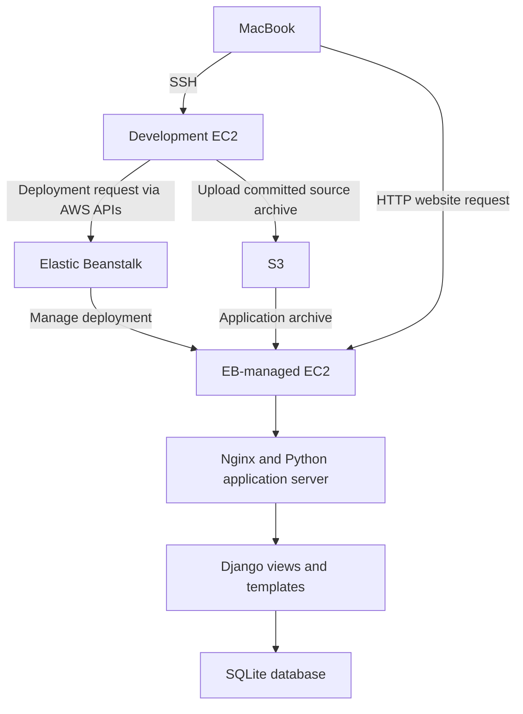

# Django Movies Application — AWS Elastic Beanstalk Lab

A learning project by **Subrata Barua**: build a Django movie catalogue, develop it on EC2, deploy it to AWS Elastic Beanstalk, release an update, and remove the hosting environment after verification.

**Recorded outcome:** the initial deployment and heading update worked in a browser, the environment reported `Ready` / `Green`, and environment termination was confirmed. The public lab website is no longer running. Source code and Git history were transferred to a Mac for GitHub storage.

This guide reconstructs the workflow completed during the lab. Commands containing placeholders such as `YOUR_EC2_PUBLIC_IP` require your own values. The build section is for a new project; do not run `startproject` over an existing clone.

## Contents

- [Architecture and terminology](#architecture-and-terminology)
- [Run an existing clone locally](#run-an-existing-clone-locally)
- [Build the project step by step](#build-the-project-step-by-step)
- [Prepare and deploy to Elastic Beanstalk](#prepare-and-deploy-to-elastic-beanstalk)
- [Update the website](#update-the-website)
- [Clean up AWS resources](#clean-up-aws-resources)
- [Transfer to Mac and upload to GitHub](#transfer-to-mac-and-upload-to-github)
- [Troubleshooting and limitations](#troubleshooting-and-limitations)

## Architecture and terminology

Two separate EC2 instances were involved:

| Component | Job |
|---|---|
| MacBook | SSH client, browser, and later the local Git/GitHub workstation |
| Development EC2 | Stores the working project; runs the development server, Git and EB CLI |
| Elastic Beanstalk | Coordinates provisioning and application deployments |
| EB-managed EC2 | Hosts the deployed application |
| Amazon S3 | Stores application deployment archives |
| IAM roles/policies | Authorize AWS API operations |
| SQLite | Stores movie and Django authentication data in a local database file |



An **IAM policy grants permission**; it does not create an SSH connection. The EB CLI sends AWS API requests using credentials available on the development machine. Elastic Beanstalk then manages the deployment. SSH access to the hosting instance is not required for `eb deploy`.

A Django **project** contains site-wide configuration. A Django **app** implements a feature. Here, the project is `demoproj` and the app is `movies`.

## Run an existing clone locally

These commands are for a Mac/Linux machine with Python 3.12 and Git installed. If the repository is already in `~/movies-project`, skip cloning.

```bash
git clone git@github.com:Subrata1608024/Django_project_Movies_Elasticbeanstalk.git ~/movies-project
cd ~/movies-project
python3.12 -m venv env
source env/bin/activate
python -m pip install -r requirements.txt
```

`venv` creates isolated dependencies. `source` activates it in this terminal. `pip install -r` installs the versions recorded by the project.

Create a local secret once. This command intentionally refuses to overwrite an existing `.env`:

```bash
python -c 'import secrets; from pathlib import Path; p = Path(".env"); p.touch(mode=0o600, exist_ok=False); p.write_text("DJANGO_SECRET_KEY=" + secrets.token_urlsafe(50) + "\n")'
set -a
source .env
set +a
export DJANGO_DEBUG=True
python manage.py migrate
python manage.py createsuperuser
python manage.py runserver 127.0.0.1:8080
```

Open `http://127.0.0.1:8080/movies/`. Add records through `http://127.0.0.1:8080/admin/` using the local superuser. Use a strong password and accept Django's validation guidance.

The `.env` file is not loaded automatically by this project. `set -a` makes variables loaded by `source .env` available to child processes; `set +a` switches that automatic exporting off. Repeat activation and environment loading in each new terminal session. Do not recreate the secret on every run.

## Build the project step by step

### 1. Connect to the development EC2

Run on the **Mac**, using the instance's current public IP:

```bash
ssh -i ~/Downloads/cpp-cde1-key.pem ec2-user@YOUR_EC2_PUBLIC_IP
```

`-i` selects the private key. A prompt containing `ec2-user@...` means commands now execute on EC2. A prompt containing `MacBook-Air` means they execute on the Mac. `~` refers to the home directory of whichever machine is executing the command.

The lab used Amazon Linux 2023 with Python 3.12, Git and AWS CLI available. Check prerequisites on EC2:

```bash
python3.12 --version
git --version
aws --version
aws sts get-caller-identity
```

The last command identifies the AWS caller. In this lab it showed an assumed `LabRole` session. It does not list all effective permissions. `LabRole` and `LabInstanceProfile` were supplied by the Learner Lab; they were not created by the Django project.

### 2. Create an isolated workspace

Run on the **development EC2**:

```bash
mkdir -p ~/gos/week05/simple_proj
cd ~/gos/week05/simple_proj
python3.12 -m venv env
source env/bin/activate
python -m pip install --upgrade pip
python -m pip install 'Django>=5.2,<5.3'
python -m django --version
```

`mkdir -p` creates the directory and missing parents. The quoted version constraint keeps Django in the 5.2 series. Use `source env/bin/activate`, not `/env/bin/activate`: a leading `/` means the filesystem root.

### 3. Generate the Django project and app

```bash
python -m django startproject demoproj
cd demoproj
python manage.py check
python manage.py migrate
python manage.py startapp movies
```

`startproject` generates the project skeleton. `check` looks for common configuration problems; it is not a full application test. The initial `migrate` creates tables for Django's built-in apps. `startapp movies` generates the app skeleton—the name `movies` is chosen by the developer.

### 4. Understand the files

Paths below are relative to the outer project folder containing `manage.py`.

| Path | Responsibility |
|---|---|
| `manage.py` | Entry point for project management commands |
| `demoproj/settings.py` | Apps, database, templates, secrets and host configuration |
| `demoproj/urls.py` | Main URL routing |
| `demoproj/wsgi.py` | WSGI entry point used by the deployment server |
| `demoproj/asgi.py` | ASGI entry point; not the entry point selected in this lab |
| `movies/apps.py` | App configuration class |
| `movies/models.py` | Movie data structure |
| `movies/migrations/` | Versioned database schema changes |
| `movies/admin.py` | Registers models with Django admin |
| `movies/views.py` | Handles requests and prepares responses |
| `movies/urls.py` | Routes movie URLs to views |
| `movies/templates/movies/` | HTML templates for list/detail pages |
| `movies/tests.py` | Generated location for app tests; tests were not demonstrated in this deployment exercise |
| `db.sqlite3` | Local database; excluded from Git |
| `requirements.txt` | Python dependency versions |
| `.ebextensions/django.config` | Elastic Beanstalk Python configuration |
| `.platform/hooks/postdeploy/01_migrate.sh` | Runs migrations after deployment |

The outer `demoproj` is the project directory; the inner `demoproj` is its Python configuration package. The extra `movies` directory inside `templates` namespaces templates to avoid collisions with other apps.

### 5. Register the app and define the model

Add this entry to `INSTALLED_APPS` in `demoproj/settings.py`, preserving the built-in entries:

```python
'movies.apps.MoviesConfig',
```

Set `movies/models.py` to:

```python
from django.db import models


class Movie(models.Model):
    title = models.CharField(max_length=200)
    director = models.CharField(max_length=30)
    release_date = models.DateTimeField('release date')
    genre = models.CharField(max_length=200)
    duration = models.FloatField()

    def __str__(self):
        return self.title + ' - ' + self.director
```

The fields describe stored values. `DateTimeField` stores date and time; `FloatField` stores a floating-point number. Use minutes consistently when entering duration. `__str__` makes records readable in admin and the Python shell.

```bash
python manage.py makemigrations movies
python manage.py migrate
```

`makemigrations` creates the schema-change file. `migrate` applies pending migration files to the database. Commit migrations so another environment can build the same schema; movie records themselves are not inside those migration files.

### 6. Enable local administration

In `movies/admin.py`:

```python
from django.contrib import admin
from .models import Movie

admin.site.register(Movie)
```

```bash
python manage.py createsuperuser
```

The registration exposes Movie management in admin. The command creates a privileged user in the current database. During local development, use admin to add a sample movie and verify it appears on the list and detail pages.

### 7. Create views and URL routes

The final views query the database and render templates. In `movies/views.py`:

```python
from django.http import Http404
from django.shortcuts import render
from .models import Movie


def index(request):
    newest_movies = Movie.objects.order_by('-release_date')[:15]
    return render(request, 'movies/index.html', {'newest_movies': newest_movies})


def show(request, movie_id):
    try:
        movie = Movie.objects.get(pk=movie_id)
    except Movie.DoesNotExist:
        raise Http404('Movie does not exist')
    return render(request, 'movies/show.html', {'movie': movie})
```

The minus sign orders newest dates first; `[:15]` limits the list. `pk` is the primary key. A missing record returns 404 rather than an unhandled server error.

Create `movies/urls.py`:

```python
from django.urls import path
from . import views

app_name = 'movies'
urlpatterns = [
    path('', views.index, name='index'),
    path('<int:movie_id>/', views.show, name='show'),
]
```

In `demoproj/urls.py`:

```python
from django.contrib import admin
from django.urls import include, path
from django.views.generic import RedirectView

urlpatterns = [
    path('', RedirectView.as_view(url='/movies/', permanent=False)),
    path('movies/', include('movies.urls')),
    path('admin/', admin.site.urls),
]
```

The root URL returns a temporary redirect to `/movies/`. `include` delegates the remainder of movie paths to the app. For `/movies/1/`, the app captures `1` as `movie_id` and calls `show`.

### 8. Create the templates

```bash
mkdir -p movies/templates/movies
```

Create `movies/templates/movies/index.html`. This minimal equivalent includes the final heading used to verify the update:

```html
<!doctype html>
<html lang="en">
<head>
    <meta charset="utf-8">
    <title>Newest Movies</title>
</head>
<body>
    <h1>Newest Movies - Week 5</h1>
    
        <ul>
        
            <li><a href="">{{ movie.title }}</a>
                - {{ movie.director }}</li>
        
        </ul>
    
        <p>There are no movies recorded.</p>
    
</body>
</html>
```

Create `movies/templates/movies/show.html` with the detail page, for example:

```html
<!doctype html>
<html lang="en">
<head>
    <meta charset="utf-8">
    <title>Movie Details</title>
</head>
<body>
    <h1>{{ movie.title }}</h1>
    <table>
        <tr><th>Director</th><td>{{ movie.director }}</td></tr>
        <tr><th>Release date</th><td>{{ movie.release_date }}</td></tr>
        <tr><th>Genre</th><td>{{ movie.genre }}</td></tr>
        <tr><th>Duration</th><td>{{ movie.duration }} minutes</td></tr>
    </table>
    <a href="">Back to movies</a>
</body>
</html>
```

`{{ ... }}` displays a value; `` controls template logic. Named URLs avoid hardcoding links. `<title>` belongs in `<head>` and labels the browser tab; `<h1>` belongs in `<body>` and displays on the page.

### 9. Move environment-specific settings out of source code

In `demoproj/settings.py`, keep the existing `Path` import and add `import os` on a separate line. Replace the corresponding settings:

```python
SECRET_KEY = os.environ['DJANGO_SECRET_KEY']
DEBUG = os.environ.get('DJANGO_DEBUG', 'False') == 'True'
ALLOWED_HOSTS = os.environ.get(
    'DJANGO_ALLOWED_HOSTS',
    '127.0.0.1,localhost'
).split(',')
```

Create and load `.env` using the commands in the local quickstart. Enable `DJANGO_DEBUG=True` only for local development. `ALLOWED_HOSTS` accepts hostnames without URL schemes or paths. The comparison for debug is case-sensitive.

The secret supports Django's cryptographic signing. It is not an SSH key or an AWS access key. An ignored `.env` stays local; the deployed application receives its settings through EB environment properties.

### 10. Test from EC2 and through an SSH tunnel

On the development EC2, with the app environment loaded:

```bash
python manage.py check
python manage.py runserver 127.0.0.1:8080
```

Leave this terminal running. In another SSH session to that same EC2:

```bash
curl -i http://127.0.0.1:8080/movies/
curl -i http://127.0.0.1:8080/
```

`curl` requests a page; `-i` includes headers. Expected results are `200 OK` for the list and `302` with `Location: /movies/` for the root redirect. Test a real movie ID and a nonexistent ID as well.

On the **Mac**, open a separate terminal and create the tunnel:

```bash
ssh -i ~/Downloads/cpp-cde1-key.pem -N \
  -L 8080:127.0.0.1:8080 ec2-user@YOUR_EC2_PUBLIC_IP
```

Open `http://127.0.0.1:8080/movies/` in the Mac browser. `-N` opens no remote shell. `-L` forwards the Mac's local port 8080 through SSH to EC2's loopback port 8080. No public inbound rule for port 8080 is needed for this tunnel; SSH must be reachable. The development server must still be running on EC2.

## Prepare and deploy to Elastic Beanstalk

Run these steps on the **development EC2**, from the directory containing `manage.py`, unless specified otherwise.

### 11. Record dependencies and deployment settings

With the project virtual environment activated:

```bash
python -m pip freeze > requirements.txt
mkdir -p .ebextensions
mkdir -p .platform/hooks/postdeploy
```

`freeze` records installed dependency versions. Keep `requirements.txt` beside `manage.py`, not beside the outer virtual environment.

In `.ebextensions/django.config`:

```yaml
option_settings:
  aws:elasticbeanstalk:container:python:
    WSGIPath: demoproj.wsgi:application
```

This identifies the Python module and WSGI application object that the platform should serve. It replaces the need to run Django's development server in the hosting environment.

In `.platform/hooks/postdeploy/01_migrate.sh`:

```bash
#!/bin/bash
set -e

cd /var/app/current
/var/app/venv/*/bin/python manage.py migrate --noinput
```

```bash
chmod +x .platform/hooks/postdeploy/01_migrate.sh
```

The hook runs on the EB instance after application deployment. `set -e` fails the script when a command fails; `--noinput` prevents interactive prompts. The wildcard selects the platform-created Python virtual environment. These `/var/app` paths belong to EB, not to the development EC2 project directory.

This hook was sufficient for this single-instance lab. It is not a complete production database-release strategy; see limitations below.

### 12. Save source in Git

Use these ignore rules:

```gitignore
env/
__pycache__/
*.pyc
db.sqlite3
.env
staticfiles/
.elasticbeanstalk/*.bak

# Elastic Beanstalk Files
.elasticbeanstalk/*
!.elasticbeanstalk/*.cfg.yml
!.elasticbeanstalk/*.global.yml
```

The last block was added during EB setup and later committed. `!` creates an exception to an ignore rule. Review any saved configuration before committing it. `.gitignore` does not remove a secret that was already committed.

For a new repository only:

```bash
git init -b main
git check-ignore -v .env db.sqlite3
git add .
git status --short
git commit -m "Add Django movies app and deployment configuration"
```

Review staged filenames before committing. `add` stages changes; `commit` records them locally. Neither operation uploads to GitHub. Ensure environment-based settings are committed before deployment.

### 13. Install the EB CLI separately

```bash
python3.12 -m venv ~/gos/ebcli-env
~/gos/ebcli-env/bin/python -m pip install awsebcli
~/gos/ebcli-env/bin/eb --version
aws sts get-caller-identity
```

A separate environment prevents deployment-tool dependencies from being mixed into the web application's requirements. AWS credentials must be available in the current lab session.

### 14. Select a platform and initialize the application

```bash
aws elasticbeanstalk list-available-solution-stacks \
  --region us-east-1 \
  --query "SolutionStacks[?contains(@, 'Python 3.12')]" \
  --output table
```

Select an available stack from the output; platform versions change. The recorded run used `64bit Amazon Linux 2023 v4.13.11 running Python 3.12`. For a new run, set the variable below to the stack returned for your account:

```bash
EB_PLATFORM='PASTE_AVAILABLE_PYTHON_3_12_SOLUTION_STACK_HERE'
~/gos/ebcli-env/bin/eb init gos-week05-movies \
  --region us-east-1 --platform "$EB_PLATFORM"
```

`eb init` connects this folder to an EB application and writes local CLI configuration. It does not yet create the running hosting environment.

### 15. Choose a hostname and create the environment

Use your own unique prefix rather than assuming the original lab hostname remains available:

```bash
EB_CNAME='YOUR_UNIQUE_CNAME_PREFIX'
aws elasticbeanstalk check-dns-availability \
  --cname-prefix "$EB_CNAME" --region us-east-1
```

Proceed only when `Available` is true. Copy the returned `FullyQualifiedCNAME` into `EB_HOST`:

```bash
EB_HOST='PASTE_FULLY_QUALIFIED_CNAME_HERE'
EB_DJANGO_SECRET=$(python -c 'import secrets; print(secrets.token_urlsafe(50))')
~/gos/ebcli-env/bin/eb create gos-week05-movies-env \
  --region us-east-1 \
  --platform "${EB_PLATFORM:?Set the platform first}" \
  --single \
  --instance_type t3.micro \
  --service-role LabRole \
  --instance_profile LabInstanceProfile \
  --cname "${EB_CNAME:?Set the CNAME prefix first}" \
  --envvars "DJANGO_SECRET_KEY=${EB_DJANGO_SECRET:?Secret is missing},DJANGO_DEBUG=False,DJANGO_ALLOWED_HOSTS=${EB_HOST:?Set the hostname first}"
```

Run this in the same terminal as the variable assignments. `${VARIABLE:?message}` stops execution if a required variable is missing. The generated secret is captured without being printed; do not print or share it.

| Option | Reason |
|---|---|
| `--single` | Uses a single-instance environment without a load balancer |
| `--instance_type t3.micro` | Selects the lab's instance size |
| `--service-role` | Assigns the existing role EB uses to manage resources |
| `--instance_profile` | Assigns the profile used by the hosting EC2 |
| `--envvars` | Supplies application configuration before startup and migration |

These role names are Learner Lab-specific. Other AWS accounts need appropriate roles and permissions configured independently. Creation provisions billable resources: terminate them when the exercise is complete.

### 16. Verify deployment

```bash
~/gos/ebcli-env/bin/eb status gos-week05-movies-env
curl -i --max-time 20 "http://${EB_HOST}/movies/"
```

Wait for deployment completion; then check `Ready`, `Green`, and `HTTP 200`. Open the same HTTP URL in the Mac browser. The public EB website does not use the development SSH tunnel.

An empty list is expected: Git excluded the local SQLite database, while migrations create the database schema on the deployed instance. The local superuser and sample movie are not transferred.

## Update the website

The original visible heading was `Newest Movies`. It was changed to `Newest Movies - Week 5` in `movies/templates/movies/index.html`, inside `<body>`.

```bash
git diff -- movies/templates/movies/index.html
git add movies/templates/movies/index.html
git commit -m "Update movies heading for Week 5"
~/gos/ebcli-env/bin/eb deploy gos-week05-movies-env
```

Editing changes only the development copy. Committing records the version. `eb deploy` uploads and deploys that committed version to the existing environment.

Refresh the browser and confirm the heading. Run `eb status` again and compare the deployed version with the new release.

Recorded evidence from this lab:

| Check | Result |
|---|---|
| Initial deployment | Completed successfully; movies page returned HTTP 200 |
| Initial application version | `app-3d18-261024_130421867829` |
| Heading-change commit | `93f7cdf` |
| Updated application version | `app-93f7-261024_142848665205` |
| Updated heading | `Newest Movies - Week 5` visible in browser |
| Health after update | Ready / Green |
| Environment cleanup | Terminated |

These are manual deployment checks, not proof of automated test coverage.

## Clean up AWS resources

Save any evidence or needed data first. This removes the hosting environment and its instance-local database; it does not remove the development project's files.

```bash
~/gos/ebcli-env/bin/eb terminate gos-week05-movies-env
```

Type the environment name when asked. An alternative, used after an SSH session interruption in this lab, is:

```bash
aws elasticbeanstalk terminate-environment \
  --environment-name gos-week05-movies-env \
  --region us-east-1
```

**The AWS CLI alternative starts termination immediately without an interactive confirmation. Use one method, not both.**

Check completion using the environment ID returned by AWS:

```bash
aws elasticbeanstalk describe-environments \
  --environment-ids YOUR_ENVIRONMENT_ID \
  --include-deleted \
  --region us-east-1 \
  --query 'Environments[*].{Name:EnvironmentName,Status:Status}' \
  --output table
```

`Terminating` means still in progress; wait and check again until `Terminated`. The original run reached `Terminated`. The application record, archived versions and S3 objects may remain; environment termination is not a statement that every account resource or storage charge has been removed.

## Transfer to Mac and upload to GitHub

### Preserve Git history in a bundle

On the development EC2, commit reviewed pending changes first:

```bash
git -C ~/gos/week05/simple_proj/demoproj status --short
git -C ~/gos/week05/simple_proj/demoproj bundle create ~/gos/week05/movies-project.bundle --all
```

A bundle packages committed objects and Git references. It excludes untracked local files, but includes historical committed content; ignoring a previously committed secret does not remove it from history.

On the **Mac**:

```bash
scp -i ~/Downloads/cpp-cde1-key.pem \
  ec2-user@YOUR_EC2_PUBLIC_IP:/home/ec2-user/gos/week05/movies-project.bundle \
  ~/Downloads/
git clone ~/Downloads/movies-project.bundle ~/movies-project
```

`scp` securely downloads the bundle. `git clone` restores an editable working copy with its history. The AWS key exists on the Mac, so the download command must run there.

### Configure SSH authentication to GitHub

A dedicated GitHub key was created on the Mac:

```bash
ssh-keygen -t ed25519 -C "Subrata MacBook GitHub" -f ~/.ssh/id_ed25519_github
```

Choose a passphrase; never overwrite an existing key unintentionally. The private key stays on the Mac. Copy only the public key:

```bash
pbcopy < ~/.ssh/id_ed25519_github.pub
```

In GitHub Settings → SSH and GPG keys → New SSH key, choose Authentication Key and paste it. `pbcopy` copies to the clipboard without printing output.

Merge the following into `~/.ssh/config` without overwriting unrelated entries:

```sshconfig
Host github.com
    HostName github.com
    User git
    IdentityFile ~/.ssh/id_ed25519_github
    IdentitiesOnly yes
    AddKeysToAgent yes
    UseKeychain yes
```

```bash
chmod 600 ~/.ssh/config
ssh -T git@github.com
```

On a first connection, compare the server fingerprint with GitHub's official fingerprints before accepting. Enter the private-key passphrase when prompted. The successful test in this lab greeted `Subrata1608024`; the message that GitHub does not provide shell access is expected.

`UseKeychain` is a macOS setting. Authentication proves your identity; configuring Git's author name/email is a separate operation. Set those to your preferred name and a verified GitHub email or GitHub-provided noreply email before future commits.

### Set the repository destination and push

Create an empty GitHub repository without an initial README/license/gitignore. This project's repository is `Subrata1608024/Django_project_Movies_Elasticbeanstalk`.

```bash
git -C ~/movies-project remote set-url origin git@github.com:Subrata1608024/Django_project_Movies_Elasticbeanstalk.git
git -C ~/movies-project remote -v
```

The bundle clone initially points `origin` at the bundle file. `set-url` changes the destination to GitHub. Readers using their own account must replace the owner/repository.

Save this document as `README.md` in the repository root, then:

```bash
cd ~/movies-project
git add README.md
git commit -m "Document Django setup and Elastic Beanstalk deployment"
git push -u origin main
```

`-u` records the upstream branch for future pushes. GitHub renders root-level `README.md` on the repository page. Verify the push output and the repository page; do not assume changing the remote alone uploads code.

## Troubleshooting and limitations

| Symptom | Explanation and next step |
|---|---|
| `python--version: command not found` | Add the missing space: `python --version`. |
| `/env/bin/activate` missing | Use the actual project path or relative `env/bin/activate`. |
| `DJANGO_SECRET_KEY` missing | Load the local environment; in EB, supply the environment property. |
| Syntax error around imports | Put `from pathlib import Path` and `import os` on separate lines. |
| Models changed but no migrations applied | Run `makemigrations movies`, then `migrate`. |
| `TemplateDoesNotExist` | Check template path, installed app and `APP_DIRS`; restart the development server if needed after creating directories. |
| Tunnel says `Connection refused` | Verify Django is running on the destination EC2 loopback port 8080. |
| Browser fails but HTTP curl returns 200 | Check whether the browser used HTTPS when only HTTP was configured. |
| `scp` cannot find the PEM under `/home/ec2-user/Downloads` | You ran it on EC2; return to the Mac terminal. |
| Log lines cause `command not found` | Output was pasted as commands; clear the prompt and enter only commands. |
| IAM `GetPolicy` access denied | This lab explicitly denied policy inspection. Do not try to bypass the restriction; deployment permissions are separate. |
| Empty deployed movie list | Expected with a fresh SQLite database; local records were excluded. |

### Scope of the lab

- This is a learning deployment, not a production-ready service.
- SQLite is stored on the application instance. Redeployment/replacement/termination can lose records. A persistent database and backups are needed for durable data.
- The migration hook runs as root after deployment; database file ownership and application write permissions need review before allowing deployed writes. Local admin use was exercised; deployed admin write access was not verified.
- HTTP was used for the public demonstration. Configure HTTPS before allowing real credentials or sensitive data through a public login.
- Production static-file collection and serving were not completed in this exercise. Django admin styling requires a deliberate static-file setup with debug disabled.
- The single-instance setup does not provide high availability. Multi-instance deployment requires coordinated migrations and persistent shared data.
- No claim of automated application test coverage is made. The earlier calculator/pytest exercise was a separate lab.
- The demonstration used pre-existing Learner Lab roles. Those roles are not a least-privilege IAM design for a production account.

## Official references

- [Django 5.2 tutorial: projects, apps and views](https://docs.djangoproject.com/en/5.2/intro/tutorial01/)
- [Django models, migrations and admin](https://docs.djangoproject.com/en/5.2/intro/tutorial02/)
- [Django deployment checklist](https://docs.djangoproject.com/en/5.2/howto/deployment/checklist/)
- [Elastic Beanstalk Python platform](https://docs.aws.amazon.com/elasticbeanstalk/latest/dg/create-deploy-python-container.html)
- [Elastic Beanstalk platform hooks](https://docs.aws.amazon.com/elasticbeanstalk/latest/dg/platforms-linux-extend.hooks.html)
- [EB create](https://docs.aws.amazon.com/elasticbeanstalk/latest/dg/eb3-create.html)
- [EB terminate](https://docs.aws.amazon.com/elasticbeanstalk/latest/dg/eb3-terminate.html)
- [GitHub SSH key setup](https://docs.github.com/en/authentication/connecting-to-github-with-ssh/generating-a-new-ssh-key-and-adding-it-to-the-ssh-agent)
- [GitHub SSH fingerprints](https://docs.github.com/en/authentication/keeping-your-account-and-data-secure/githubs-ssh-key-fingerprints)
